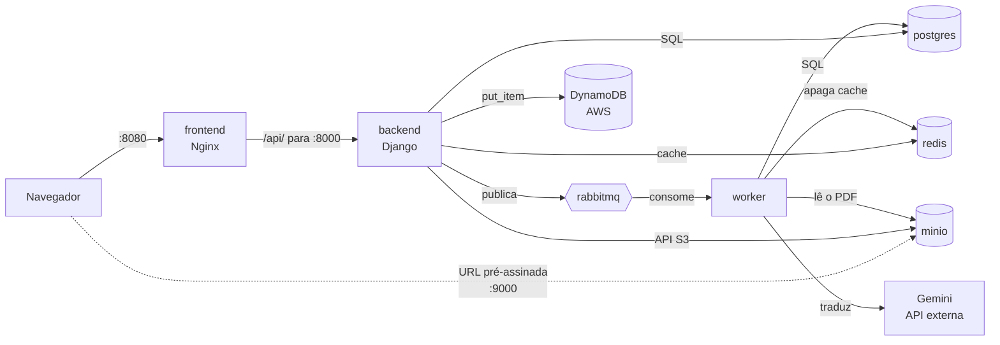
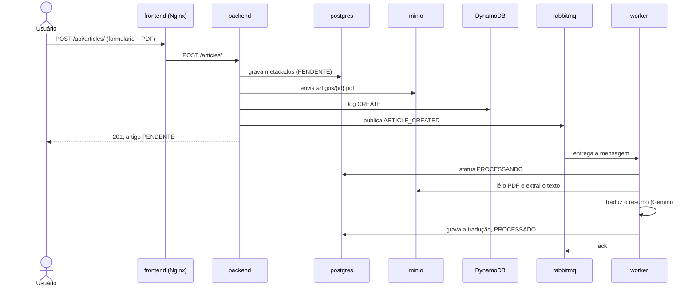
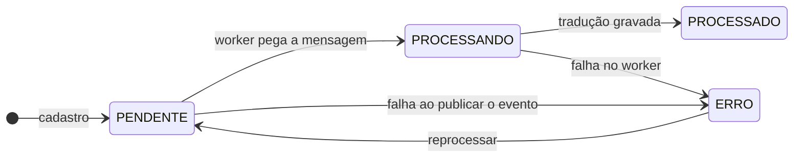
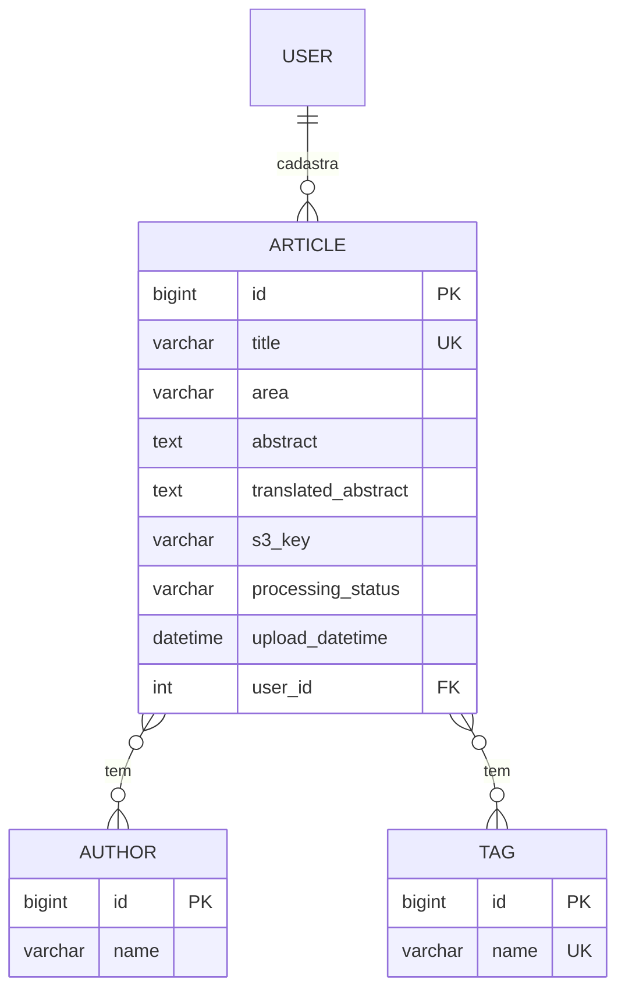

# Repositório de Artigos Acadêmicos

Aplicação web para cadastrar, buscar e baixar artigos acadêmicos. Projeto da disciplina de Desenvolvimento de Software para Nuvem.

- **Trabalho 2 (este README):** a mesma aplicação rodando com **Docker e Docker Compose**. O RDS virou um container Postgres, o S3 virou um container MinIO e o SNS/SQS virou um container RabbitMQ. O DynamoDB continua na AWS, como a especificação pede.

## O que faz

Alunos e pesquisadores cadastram trabalhos (título, autores, resumo, palavras-chave e área) e enviam o PDF. Qualquer pessoa pode listar, buscar e baixar os artigos. Depois do envio, o sistema extrai o texto do PDF e traduz o resumo para o inglês, sem fazer o usuário esperar.

## Arquitetura



Sete containers sobem pelo `docker-compose.yml`, todos na rede `artigos-network`, onde se enxergam pelo nome do serviço.

| Serviço | Imagem | Papel | Substitui (trabalho 1) |
|---|---|---|---|
| `frontend` | Dockerfile próprio (`nginx:alpine`) | Serve as telas e encaminha `/api/` ao backend | Bucket S3 do site |
| `backend` | Dockerfile próprio (`python:3.12-slim`) | API Django: valida, grava, publica o evento | EC2 da API, ALB |
| `worker` | Dockerfile próprio (`python:3.12-slim`) | Consome a fila, extrai o texto do PDF e traduz o resumo | EC2 do worker |
| `postgres` | `postgres:16` | Metadados dos artigos | RDS |
| `minio` | `cgr.dev/chainguard/minio:latest` | PDFs (bucket privado, download por URL pré-assinada) | S3 |
| `rabbitmq` | `rabbitmq:3-management` | Fila `artigos.criados` com DLQ | SNS e SQS |
| `redis` | `redis:7-alpine` | Cache de consultas (nunca guarda PDF) | ElastiCache |
| DynamoDB | serviço da AWS | Log de cada criação, atualização e exclusão | (igual) |

Volumes nomeados (`postgres_data`, `minio_data`, `rabbitmq_data`) mantêm banco, PDFs e filas depois de um `docker compose down`.

## Como executar

### Pré-requisitos

- Docker com Docker Compose v2 (`docker compose version`).
- Uma chave da API do Gemini (`GEMINI_API_KEY`) e o nome do modelo (`GEMINI_MODEL`). Sem elas o artigo é cadastrado, mas a tradução termina em `ERRO`.
- Uma tabela no DynamoDB e credenciais da AWS (ver [DynamoDB](#dynamodb-o-único-serviço-na-aws)).
- As portas 8080, 8000, 9000, 9001, 5432, 5672, 15672 e 6379 livres na máquina (ver [Convivência com outros containers](#convivência-com-outros-containers)).

### Passo a passo

**1. Baixar o código**

```
git clone https://github.com/EstherMart/article-cloud-development.git
cd article-cloud-development
```

**2. Criar o `.env` na raiz do repositório**

```
cp .env.example .env
```

Abra o `.env` e preencha os valores em branco. O arquivo não vai para o Git (está no `.gitignore`).

| Variável | O que colocar |
|---|---|
| `POSTGRES_USER` | `admin` (ver a observação abaixo) |
| `POSTGRES_PASSWORD` | Uma senha à sua escolha |
| `POSTGRES_DB` e `DB_NAME` | `artigos` |
| `DB_USER`, `DB_PASSWORD` | **Iguais** a `POSTGRES_USER` e `POSTGRES_PASSWORD`: é com eles que o backend e o worker entram no banco |
| `MINIO_ROOT_USER`, `MINIO_ROOT_PASSWORD` | Login do MinIO (a senha precisa de pelo menos 8 caracteres). O backend e o worker usam os mesmos valores como chave de acesso |
| `RABBITMQ_DEFAULT_USER`, `RABBITMQ_DEFAULT_PASS` | Login do RabbitMQ. Backend e worker usam os mesmos |
| `GEMINI_API_KEY`, `GEMINI_MODEL` | Chave e modelo do Gemini (tradução). Nunca versione a chave |
| `DJANGO_SECRET_KEY` | Qualquer texto longo (só é obrigatório com `DJANGO_DEBUG=False`) |
| `DYNAMODB_TABLE`, `AWS_REGION` | Tabela e região do DynamoDB |
| `AWS_ACCESS_KEY_ID`, `AWS_SECRET_ACCESS_KEY` (e `AWS_SESSION_TOKEN`) | Credenciais para o backend gravar no DynamoDB. **Não estão no `.env.example`: acrescente as linhas** |

> **Use `POSTGRES_USER=admin`.** O healthcheck do Postgres no `docker-compose.yml` está escrito com `-U admin -d artigos` fixos. Com outro usuário ou outro nome de banco, o container nunca fica `healthy` e o backend não sobe.

Os valores `DB_HOST=postgres`, `MINIO_ENDPOINT_URL=http://minio:9000`, `RABBITMQ_HOST=rabbitmq` e `REDIS_URL=redis://redis:6379/0` já vêm certos no `.env.example`: dentro do Docker, `localhost` seria o próprio container, então usa-se o nome do serviço. `DB_SSLMODE=disable` também precisa ficar: o Postgres do container não tem TLS e o worker exige SSL por padrão.

**3. Gerar as imagens**

```
docker compose build
```

Constrói as imagens do `backend`, do `worker` e do `frontend` a partir dos três Dockerfiles. As demais (`postgres`, `minio`, `rabbitmq`, `redis`) são baixadas prontas.

**4. Subir os serviços**

```
docker compose up -d
```

Um único comando inicia os sete serviços, na ordem certa: o backend espera o Postgres e o RabbitMQ ficarem `healthy`, e o worker espera o RabbitMQ.

**5. Criar as tabelas (obrigatório na primeira vez)**

```
docker compose exec backend python manage.py migrate
```

O container do backend **não roda as migrations sozinho**. Sem este passo as telas abrem, mas a API responde erro, pois as tabelas não existem. O `migrate` também cria 12 artigos de demonstração (`SEED_DEMO_DATA=0` no `.env` desliga isso). Repetir o comando é seguro.

**6. Conferir**

```
docker compose ps                 # os sete serviços "running"; postgres e rabbitmq "healthy"
docker compose logs -f worker     # deve aparecer "Worker iniciado; aguardando mensagens na fila artigos.criados."
```

**7. Usar**

| Endereço | O que é |
|---|---|
| http://localhost:8080 | Telas (comece por aqui) |
| http://localhost:8000/health/ | Health check da API |
| http://localhost:9001 | Console do MinIO (login do `.env`) |
| http://localhost:15672 | Painel do RabbitMQ (login do `.env`) |

Em **Cadastro**, crie uma conta e entre. Em **Novo artigo**, preencha o formulário e envie um PDF (há exemplos em `backend/articles/tests/fixtures/pdfs/`). O artigo aparece como `PENDENTE`, passa por `PROCESSANDO` e termina `PROCESSADO`, com o resumo traduzido; recarregue a página do artigo para ver a mudança. O botão **Baixar PDF** baixa o arquivo direto do MinIO.

Os artigos de demonstração não têm PDF no MinIO. Para gerar e enviar os PDFs deles: `docker compose exec backend python manage.py carregar_demo_pdfs`.

**8. Parar**

```
docker compose down        # remove os containers e a rede; os dados (volumes) ficam
docker compose down -v     # também apaga os volumes: perde banco, PDFs e filas
```

### DynamoDB: o único serviço na AWS

A especificação manda continuar usando o banco não relacional da AWS. Por isso não há container para ele: o backend grava na tabela real, pela internet.

- Crie a tabela uma vez no console da AWS, com o nome de `DYNAMODB_TABLE` (padrão `logs_crud`), chave de partição `article_id` (String) e chave de ordenação `timestamp` (String). 
- Coloque as credenciais da AWS no `.env` (tabela acima). O container não enxerga `~/.aws` nem a role de uma EC2 por padrão.
- Credenciais temporárias (por exemplo, as do Learner Lab) expiram com a sessão: troque no `.env` e rode `docker compose up -d` de novo.
- **Falha de log não derruba a API**: se a gravação falhar, o cadastro continua e só aparece o erro no log. Para conferir: `docker compose logs backend | grep "gravar o log"` (se aparecer, falhou) e olhe a tabela no console da AWS.
- Hoje a aplicação **grava** o log; ainda não há tela nem rota que o consulte.

### Convivência com outros containers

O Compose isola o que é dele: rede e volumes levam o nome do projeto (a pasta do repositório), então `docker compose down` e `down -v` **só afetam este projeto**. Mas dois itens são fixos e podem colidir com outros projetos na mesma máquina:

- **Nomes de container fixos** (`artigos-backend`, `artigos-postgres` etc.). Se existir outro container com o mesmo nome, o `up` falha.
- **Portas do host.** Se outro projeto usa 5432, 6379, 8000 ou outra da lista acima, o `up` falha ao publicar a porta. Nesse caso mude só o número da **esquerda** em `ports:` (por exemplo, `"5433:5432"`). Os containers continuam se falando pela porta interna. Não altere a 9000 sem ajustar `MINIO_PUBLIC_ENDPOINT_URL` e a 8080 sem ajustar `CORS_ALLOWED_ORIGINS` e `FRONT_URL`.

Use sempre `docker compose ...` dentro da pasta deste repositório e **evite** `docker rm`, `docker system prune` e `docker volume prune` soltos: eles atingem containers e volumes de outros projetos.

## Como funciona

**Cadastro e processamento.** A API valida o pedido, grava os metadados no Postgres, envia o PDF ao MinIO, apaga o cache, registra o log no DynamoDB e publica o evento no RabbitMQ. Responde na hora com o artigo `PENDENTE`. O worker consome o evento, traduz o resumo e marca o artigo como `PROCESSADO`.



Se a publicação falhar, o artigo vira `ERRO` e a API responde 503 (o dono pode reenviar em `POST /articles/<id>/reprocess/`). Se o worker falhar, o artigo vira `ERRO`, a mensagem volta à fila e, depois de 3 reentregas, vai para a DLQ `artigos.criados.dlq`. Detalhes em [docs/docker/rabbitmq.md](docs/docker/rabbitmq.md).

**Consulta e download.** A leitura passa pelo cache Redis: se a chave existe, devolve o JSON guardado; senão consulta o Postgres e grava com validade de 300 s. Escritas (criar, editar, excluir) e o worker apagam as chaves afetadas. O PDF nunca passa pela API: ela devolve uma URL pré-assinada do MinIO (300 s) e o navegador baixa direto dele, pela porta 9000.

### Estados de um artigo



### Modelo de dados



Fora do Postgres: o DynamoDB guarda o log de cada operação, o MinIO guarda o PDF e o Redis guarda cópias temporárias das consultas.

## Estrutura do repositório

```
.
├── docker-compose.yml  Sobe os sete serviços
├── .env.example        Modelo das variáveis (copie para .env)
├── backend/            API Django, Dockerfile, testes e migrations (backend/README.md)
├── frontend/           Telas em HTML, Bootstrap e JavaScript, Dockerfile e nginx.conf (frontend/README.md)
├── worker/             Consumidor da fila: extrai o texto e traduz, Dockerfile (worker/README.md)
├── .github/workflows/  Pipeline de deploy (deploy.yml)
├── docs/docker/        Como o Docker foi montado e estudo para a arguição (trabalho 2)
├── docs/aws/           Passo a passo do trabalho 1 na AWS
├── infra/              Scripts do trabalho 1 (publicação do front no S3)
└── img/                Diagramas do trabalho 1 (arquitetura na AWS)
```
