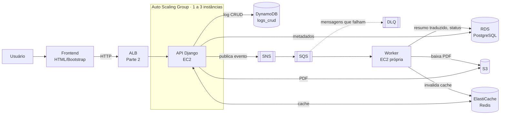
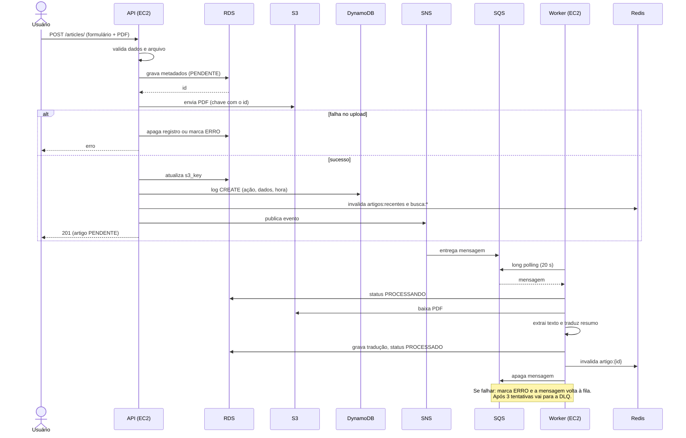
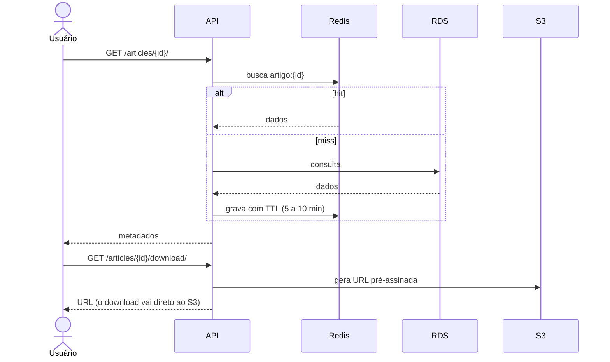
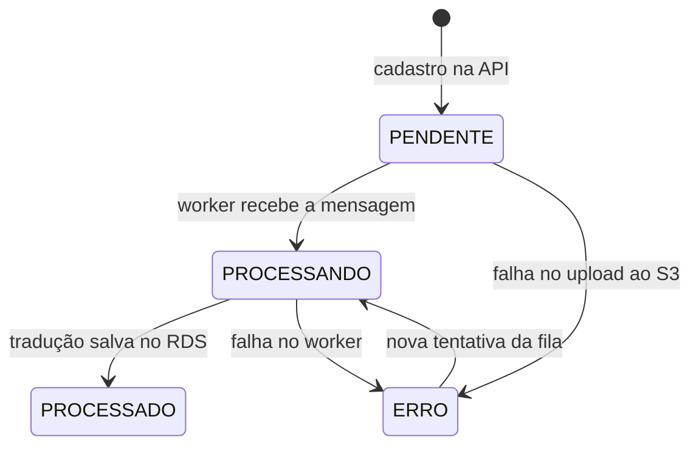

# Repositório de Artigos Acadêmicos

Trabalho Prático 1 de Desenvolvimento de Software para Nuvem (professores Paulo A. L. Rego e Fernando A. M. Trinta).

**Entrega:** 10/10/2026 às 23h59. Link do git e vídeo da Parte 2 funcionando.

## O que é

Um repositório onde alunos e pesquisadores cadastram trabalhos acadêmicos (título, autores, resumo, palavras-chave, área) e enviam o PDF do artigo. Qualquer pessoa pode listar, buscar e baixar os trabalhos. Depois do envio, o sistema extrai o texto do PDF e traduz o resumo automaticamente, sem travar quem fez o upload.

A aplicação cumpre os dois requisitos da spec:

- **Parte 1:** usar 6 serviços da AWS (EC2, S3, RDS, ElastiCache, DynamoDB e SNS/SQS), com CRUD, um arquivo binário (o PDF) e processamento desacoplado.
- **Parte 2:** tornar a API elástica com Load Balancer e Auto Scaling Group (de 1 a 3 instâncias, escalando por CPU).

## Como funciona

Cada serviço tem um papel único. O PDF vai para o S3, os metadados para o RDS, o cache para o Redis, os logs para o DynamoDB e o processamento pesado roda fora da API, via SNS/SQS.

1. **Cadastro.** O usuário preenche o formulário e anexa o PDF. A API valida, grava os metadados no RDS com status `PENDENTE`, envia o PDF ao S3, registra o log no DynamoDB e publica um evento no SNS. Responde logo, sem esperar a tradução.
2. **Processamento.** O SNS entrega o evento numa fila SQS. O worker baixa o PDF, extrai o texto, traduz o resumo, grava no RDS, marca o artigo como `PROCESSADO` e invalida o cache. Só então apaga a mensagem da fila.
3. **Consulta.** A API procura no Redis. Se achar, devolve direto. Se não, consulta o RDS, grava no Redis com TTL e devolve. O PDF é baixado do S3 por URL pré-assinada, nunca passa pelo Redis.

## Serviços AWS

| Serviço | Papel | Exigência da spec |
|---|---|---|
| EC2 | Roda a API e, em outra instância, o worker | Requisito 1 |
| RDS (PostgreSQL) | Metadados dos artigos | Requisito 2 |
| S3 | Guarda o PDF (bucket privado, download por URL pré-assinada) | Requisito 3 |
| ElastiCache (Redis) | Cache de consultas frequentes: metadados, listas, buscas. Nunca guarda PDF | Requisito 4 |
| DynamoDB | Log das ações de CRUD: tipo da ação, dados manipulados e hora (`logs_crud`) | Requisito 5 |
| SNS/SQS | Desacopla a API do worker que extrai e traduz | Requisito 6 |
| ALB + Auto Scaling | Elasticidade horizontal da API | Parte 2 |

Cada serviço ausente desconta 1,5 ponto. Sem interface gráfica, desconta 1,0.

## Diagramas

### Visão geral (componentes)



### Cadastro e processamento (sequência)



### Consulta com cache (sequência)



### Estados de um artigo



Os diagramas usam Mermaid e aparecem renderizados no GitHub.

## Estrutura do repositório

```
.
├── backend/    API Django (ver backend/README.md)
│   └── articles/services/   camada por serviço AWS (esqueleto, ver services/README.md)
├── frontend/   Telas estáticas HTML/Bootstrap (ver frontend/README.md)
│   └── js/                  scripts das telas e acesso à API (ver js/README.md)
├── worker/     Consumidor SQS: extração e tradução (ver worker/README.md)
├── infra/      Parte 2: ALB e Auto Scaling, scripts de setup (ver infra/README.md)
└── docs/
    ├── arquitetura.md   fluxos, modelo de dados, decisões técnicas
    ├── aws-setup.md     passo a passo de criação dos recursos AWS
    └── fluxo-git.md     branches, PRs e convenções
```

Cada pasta tem um README próprio com o que existe, o que falta e como rodar.

## Como começar

```
cd backend
python -m venv .venv && source .venv/bin/activate
pip install -r requirements.txt
cp .env.example .env        # preencha; sem DB_HOST usa SQLite local
set -a; source .env; set +a
python manage.py makemigrations && python manage.py migrate
python manage.py runserver
```

O front abre direto no navegador (`frontend/index.html`). Detalhes em `backend/README.md` e `frontend/README.md`.

## Status

| Item | Estado |
|---|---|
| Projeto Django, models, GET `/articles/` | feito |
| Settings por variável de ambiente (RDS/SQLite) | feito |
| Telas do front (sem JavaScript) | feito |
| Conexão com o RDS | pendente |
| CRUD real, validação | pendente |
| Upload no S3 e URL pré-assinada | pendente |
| Log no DynamoDB | pendente |
| Cache Redis | pendente |
| SNS/SQS e worker | pendente |
| JavaScript do front integrado à API | pendente |
| Parte 2 (ALB e Auto Scaling) | pendente, a pesquisar |

## Regras do time

- Ninguém commita direto na `main`. Use branch `feat/...` e PR revisado (ver `docs/fluxo-git.md`).
- Nenhuma credencial no código ou no chat. Use `.env` (ignorado pelo git) e, na EC2, a IAM Role (LabRole).
- A API é stateless: nada de uploads em disco local, sessão em memória ou cache no processo.
- RDS e ElastiCache cobram por hora. Use instâncias pequenas e apague tudo após a entrega.
