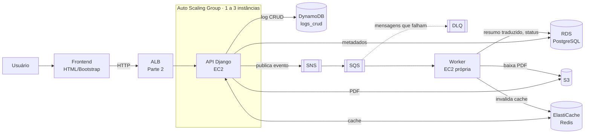
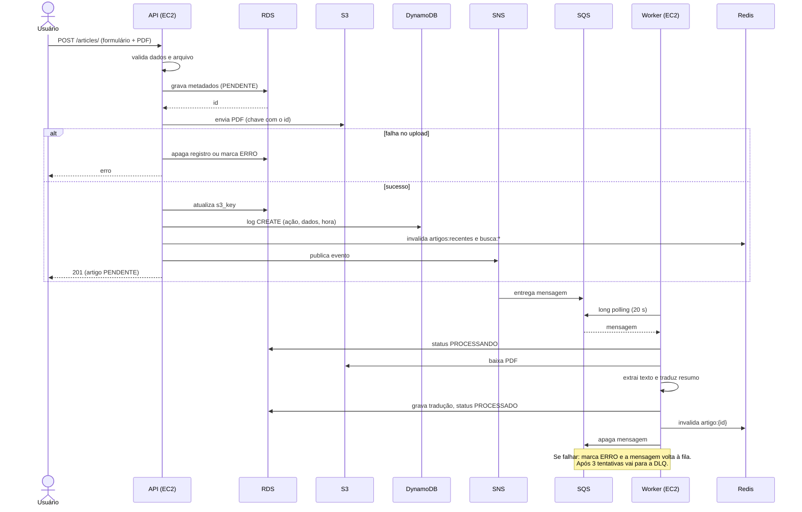
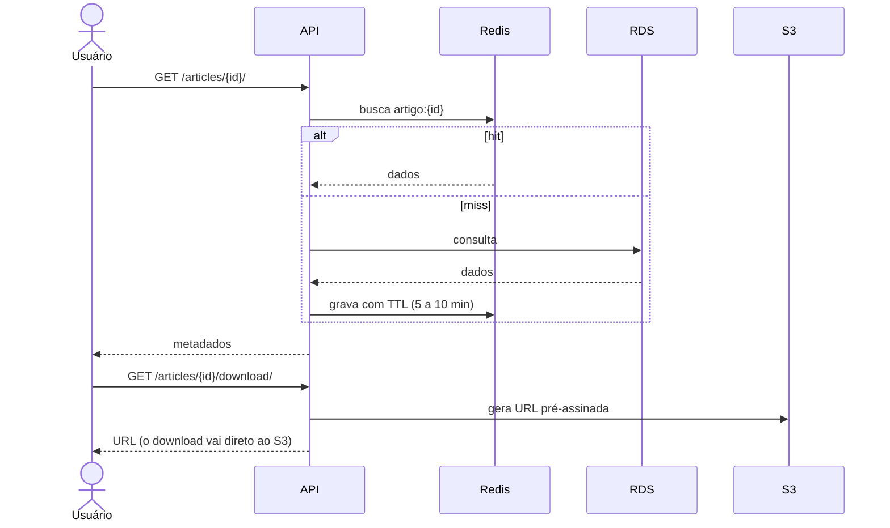
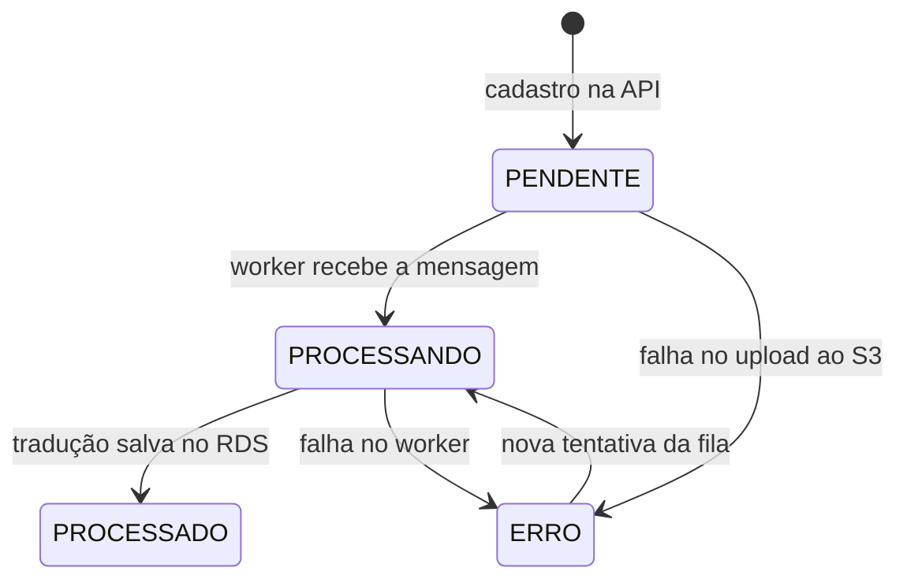
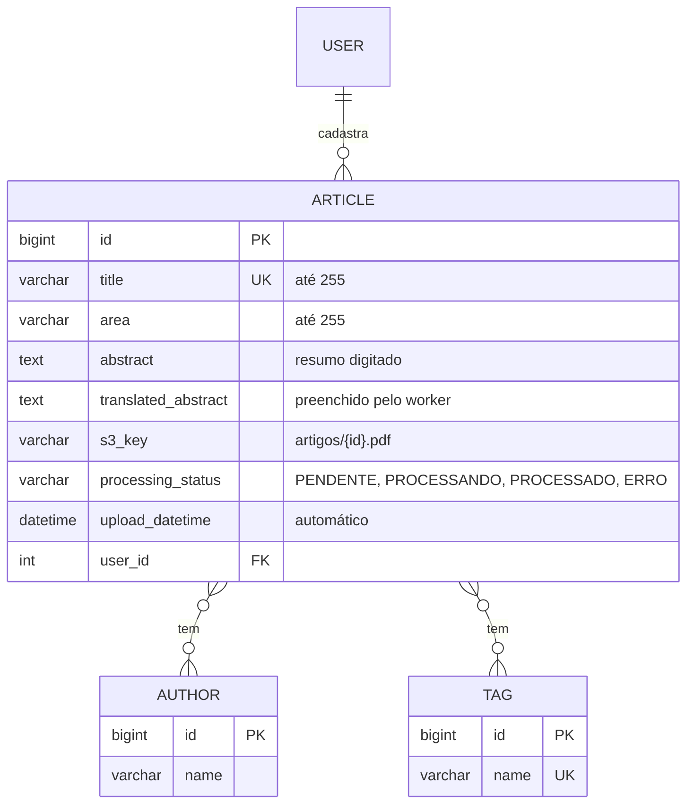

# Repositório de Artigos Acadêmicos

Trabalho Prático 1 de Desenvolvimento de Software para Nuvem (professores Paulo A. L. Rego e Fernando A. M. Trinta).

**Equipe:**

## O que é

Um repositório onde alunos e pesquisadores cadastram trabalhos acadêmicos (título, autores, resumo, palavras-chave, área) e enviam o PDF do artigo. Qualquer pessoa pode listar, buscar e baixar os trabalhos. Depois do envio, o sistema extrai o texto do PDF e traduz o resumo automaticamente, sem travar quem fez o upload.

A aplicação cumpre os dois requisitos da spec:

- **Parte 1:** usar 6 serviços da AWS (EC2, S3, RDS, ElastiCache, DynamoDB e SNS/SQS), com CRUD, um arquivo binário (o PDF) e processamento desacoplado.
- **Parte 2:** tornar a API elástica com Load Balancer e Auto Scaling Group (de 1 a 3 instâncias, escalando por CPU).

## Como funciona

Cada serviço tem um papel único. O PDF vai para o S3, os metadados para o RDS, o cache para o Redis, os logs para o DynamoDB e o processamento pesado roda fora da API, via SNS/SQS.

1. **Cadastro.** O usuário preenche o formulário e anexa o PDF. A API valida, grava os metadados no RDS com status `PENDENTE`, envia o PDF ao S3, registra o log no DynamoDB e publica um evento no SNS. Responde logo, sem esperar a tradução.
2. **Processamento.** O SNS entrega o evento numa fila SQS. O worker baixa o PDF, extrai o texto, traduz o resumo, grava no RDS, marca o artigo como `PROCESSADO` e invalida o cache. Só então apaga a mensagem da fila.
3. **Consulta.** A API procura no Redis. Se achar, devolve direto. Se não, consulta o RDS, grava no Redis com TTL e devolve. O PDF é baixado do S3 por URL pré-assinada, nunca passa pelo Redis.

## Serviços AWS

| Serviço | Papel | Exigência da spec |
|---|---|---|
| EC2 | Roda a API e, em outra instância, o worker | Requisito 1 |
| RDS (PostgreSQL) | Metadados dos artigos | Requisito 2 |
| S3 | Guarda o PDF (bucket privado, download por URL pré-assinada) | Requisito 3 |
| ElastiCache (Redis) | Cache de consultas frequentes: metadados, listas, buscas. Nunca guarda PDF | Requisito 4 |
| DynamoDB | Log das ações de CRUD: tipo da ação, dados manipulados e hora (`logs_crud`) | Requisito 5 |
| SNS/SQS | Desacopla a API do worker que extrai e traduz | Requisito 6 |
| ALB + Auto Scaling | Elasticidade horizontal da API | Parte 2 |

## Diagramas

### Visão geral (componentes)



### Cadastro e processamento (sequência)



### Consulta com cache (sequência)



### Estados de um artigo




## Modelo de dados

O RDS guarda os metadados em três tabelas e uma tabela de ligação para cada relação N:N. O app Django `articles` cria tudo pelas migrations.



| Decisão | Motivo |
|---|---|
| `Author` é uma tabela própria (N:N) | A spec fala em "autores". Um autor pode ter vários artigos |
| `title` é único | Evita cadastro duplicado do mesmo trabalho |
| `s3_key` fica vazia até o upload | O id do RDS entra na chave do S3, então o registro nasce primeiro |
| `translated_abstract` só o worker escreve | A API nunca espera a tradução |
| Apagar o usuário apaga os artigos (`CASCADE`) | Simplifica o laboratório. Revise antes de usar em produção |

Fora do RDS: o DynamoDB guarda o log de cada CRUD (`logs_crud`), o S3 guarda o PDF e o Redis guarda cópias temporárias das consultas.

## Estrutura do repositório

```
.
├── backend/    API Django e testes unitários (ver backend/README.md)
│   └── articles/services/   camada por serviço AWS (esqueleto, ver services/README.md)
├── frontend/   Telas estáticas HTML/Bootstrap (ver frontend/README.md)
│   └── js/                  scripts das telas e acesso à API (ver js/README.md)
├── worker/     Consumidor SQS: extração e tradução (ver worker/README.md)
├── infra/      Parte 2: ALB e Auto Scaling, scripts de setup (ver infra/README.md)
└── docs/
    └── aws/   passo a passo de cada serviço AWS (ver docs/aws/README.md)
```

Cada pasta tem um README próprio com o que existe, o que falta e como rodar.

## Índice da documentação

| Documento | Para quê |
|---|---|
| [backend/README.md](backend/README.md) | API, rotas, modelo de dados, migrations e testes |
| [backend/articles/services/README.md](backend/articles/services/README.md) | Camada de cada serviço AWS |
| [backend/articles/tests/integration/README.md](backend/articles/tests/integration/README.md) | Testes de integração com a AWS real (desligados por padrão) |
| [frontend/README.md](frontend/README.md) e [frontend/js/README.md](frontend/js/README.md) | Telas e scripts |
| [worker/README.md](worker/README.md) | Processamento assíncrono |
| [infra/README.md](infra/README.md) | Parte 2 (ALB e Auto Scaling) |
| [docs/aws/README.md](docs/aws/README.md) | Criar, testar e apagar cada serviço AWS, mais o estudo para a arguição |

## Decisões técnicas

- **Redis não guarda PDF.** Um PDF tem vários MB e o ElastiCache é memória cara. Cacheie metadados, listas e buscas. O PDF sai do S3 por URL pré-assinada.
- **Ordem das gravações.** RDS primeiro para obter o id, depois S3 com o id na chave, depois `s3_key`, log e SNS. Se o upload falhar, apague o registro ou marque ERRO.
- **Invalidação do cache.** Todo CREATE, UPDATE e DELETE apaga as chaves afetadas (`artigo:{id}`, `artigos:recentes`, `busca:*`). O worker também invalida `artigo:{id}`. O TTL de 5 a 10 minutos é a rede de segurança.
- **Segurança.** Sem chaves no código, IAM Role na EC2 (LabRole), RDS e Redis em Security Groups que só aceitam as instâncias da aplicação, bucket S3 privado.
- **Stateless.** Sessão, uploads e cache vão para S3 e Redis, nunca para disco ou memória da EC2. Isso evita retrabalho na Parte 2.
- **Custos.** RDS e ElastiCache cobram por hora mesmo parados. Use t3.micro e cache.t3.micro, desligue ao fim do dia e apague tudo após a entrega.

## Pontos em aberto

- Chave e atributos da tabela `logs_crud` (a sugestão é partição `article_id` e ordenação `timestamp`).
- Formato final da mensagem SNS/SQS.
- Autenticação de usuários (o front tem login e cadastro, o back ainda não).

## Como rodar localmente

Requisitos: Python 3.12 ou mais novo (o Django 6.1 não roda em versões anteriores). Sem `DB_HOST` o backend usa SQLite, então não precisa de banco nem de AWS para ver as telas.

**1. Backend** (terminal 1)

```
cd backend
python3.12 -m venv .venv && source .venv/bin/activate
pip install -r requirements.txt
cp .env.example .env
set -a; source .env; set +a
python manage.py migrate
python manage.py runserver          # http://127.0.0.1:8000
```

**2. Frontend** (terminal 2)

```
cd frontend
python3 -m http.server 8080         # http://127.0.0.1:8080
```

Abra `http://127.0.0.1:8080`, crie uma conta em **Cadastro** e entre. A lista, a busca e o detalhe funcionam só com o SQLite.

**Trocar a porta do front.** Se a 8080 estiver ocupada, suba o front em outra porta e libere a origem no backend, porque o CORS só aceita as origens da lista:

```
python3 -m http.server 5500
export CORS_ALLOWED_ORIGINS=http://127.0.0.1:5500,http://localhost:5500   # antes do runserver
```

Use o mesmo endereço no navegador e no CORS (`127.0.0.1` e `localhost` são origens diferentes). Se a API não estiver em `127.0.0.1:8000`, ajuste `API_BASE_URL` em `frontend/js/config.js`.

**Com a AWS.** Criar artigo, baixar o PDF e excluir usam o S3. Para isso, defina no `.env` as credenciais e o bucket (`AWS_STORAGE_BUCKET_NAME`, `AWS_S3_REGION_NAME`). Passo a passo de cada serviço em [docs/aws/](docs/aws/README.md).

**Testes**

```
cd backend
python manage.py test               # unitários, sem AWS (os de integração ficam desligados)
```

**Problemas comuns**

| Sintoma | Causa |
|---|---|
| Tela abre, mas a lista fica vazia e o console mostra erro de CORS | A origem do front não está em `CORS_ALLOWED_ORIGINS` |
| "Não foi possível conectar à API" | O backend não está no ar, ou `API_BASE_URL` aponta para outra porta |
| Login redireciona sempre para `login.html` | Sessão expirou (token vale 7 dias) ou foi gerada com outra `DJANGO_SECRET_KEY` |
| Erro ao criar artigo | O S3 não está configurado |

Detalhes em `backend/README.md` e `frontend/README.md`.

## Status

| Item | Estado |
|---|---|
| Projeto Django, models, migrations | feito |
| Settings por variável de ambiente (RDS/SQLite) | feito |
| CRUD e busca no banco (`/articles/`) | feito, com testes |
| Telas do front (HTML/Bootstrap) | feito |
| Conexão com o RDS | pendente de validar na AWS |
| Upload no S3 e URL pré-assinada | pendente |
| Log no DynamoDB | pendente |
| Cache Redis | pendente |
| SNS/SQS e worker | pendente |
| Autenticação (hoje o POST recebe o `username` no JSON) | pendente |
| JavaScript do front integrado à API | pendente |
| Parte 2 (ALB e Auto Scaling) | pendente, a pesquisar |

## Regras do time
- RDS e ElastiCache cobram por hora. Use instâncias pequenas e apague tudo após a entrega.
