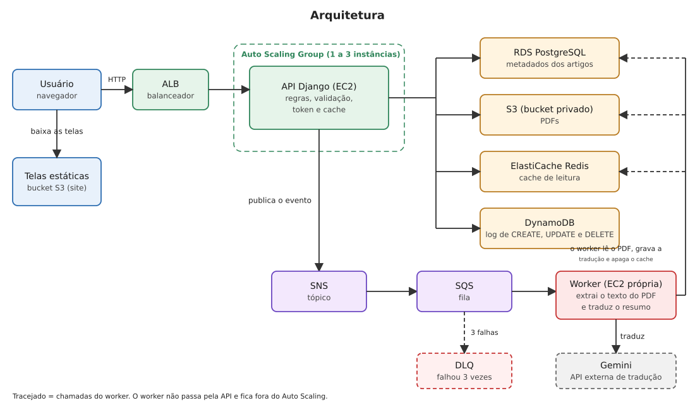
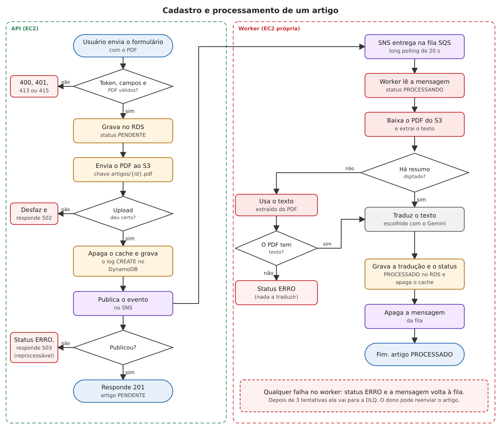
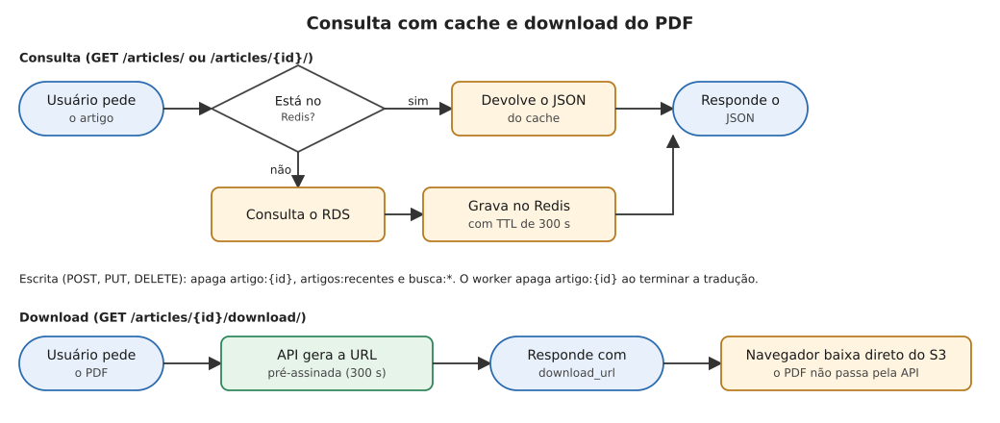
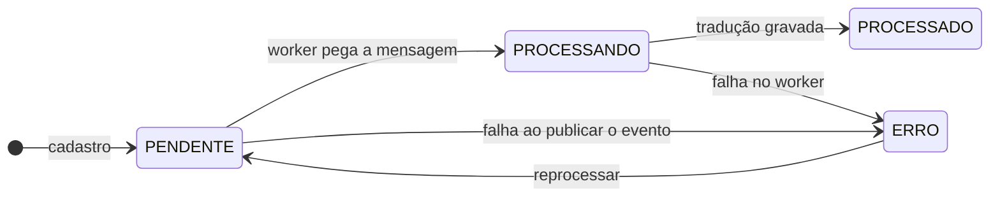
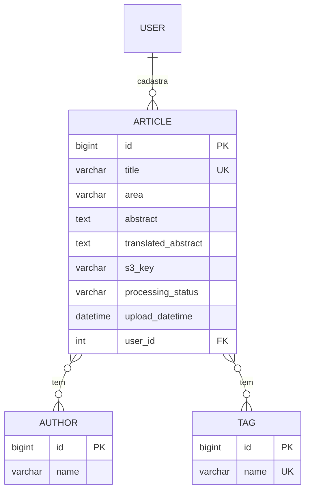

# Repositório de Artigos Acadêmicos

Aplicação web para cadastrar, buscar e baixar artigos acadêmicos, construída sobre serviços da AWS. Projeto da disciplina de Desenvolvimento de Software para Nuvem.

## O que faz

Alunos e pesquisadores cadastram trabalhos (título, autores, resumo, palavras-chave e área) e enviam o PDF. Qualquer pessoa pode listar, buscar e baixar os artigos. Depois do envio, o sistema extrai o texto do PDF e traduz o resumo para o inglês, sem fazer o usuário esperar.

## Arquitetura



| Serviço | Papel |
|---|---|
| EC2 | Roda a API (em um Auto Scaling Group, atrás de um ALB) e, em outra instância, o worker |
| RDS (PostgreSQL) | Metadados dos artigos: título, autores, palavras-chave, status |
| S3 | PDFs (bucket privado, download por URL pré-assinada) e as telas estáticas (outro bucket) |
| ElastiCache (Redis) | Cache de consultas frequentes: metadados, listas e buscas. Nunca guarda PDF |
| DynamoDB | Log de cada criação, atualização e exclusão, com ação, dados e hora |
| SNS e SQS | Avisam o worker de que há um artigo novo, sem a API esperar (com fila de descarte) |

## Como funciona

**Cadastro e processamento.** A API valida o pedido, grava os metadados no RDS, envia o PDF ao S3, registra o log e publica um evento. Responde na hora com o artigo `PENDENTE`. O worker consome o evento, traduz o resumo e marca o artigo como `PROCESSADO`.



**Consulta e download.** A leitura passa pelo cache. O PDF nunca passa pela API: o navegador baixa direto do S3 por uma URL temporária.



### Estados de um artigo



### Modelo de dados



Fora do RDS: o DynamoDB guarda o log de cada operação, o S3 guarda o PDF e o Redis guarda cópias temporárias das consultas.

## Estrutura do repositório

```
.
├── backend/    API Django, testes e migrations (backend/README.md)
├── frontend/   Telas estáticas em HTML, Bootstrap e JavaScript (frontend/README.md)
├── worker/     Consumidor da fila: extrai o texto e traduz (worker/README.md)
├── infra/      Scripts de infraestrutura (infra/README.md)
├── docs/aws/   Passo a passo para criar e testar cada serviço na AWS
└── img/        Diagramas deste README
```

## Como rodar localmente

Requisitos: Python 3.12 ou mais novo. Sem `DB_HOST` o backend usa SQLite, então não precisa de banco nem de AWS para ver as telas.

**Backend** (terminal 1)

```
cd backend
python3.12 -m venv .venv && source .venv/bin/activate
pip install -r requirements.txt
cp .env.example .env
set -a; source .env; set +a
python manage.py migrate
python manage.py runserver          # http://127.0.0.1:8000
```

O `migrate` também cria 12 artigos de demonstração. `SEED_DEMO_DATA=0` no `.env` desliga isso.

**Frontend** (terminal 2)

```
cd frontend
python3 -m http.server 8080         # http://127.0.0.1:8080
```

Abra `http://127.0.0.1:8080`, crie uma conta em **Cadastro** e entre. Lista, busca e detalhe funcionam só com o SQLite. Criar artigo, baixar PDF e a tradução usam a AWS (S3, SNS e o worker); o passo a passo está em [docs/aws](docs/aws/README.md).

Se o front rodar em outra porta, inclua a origem em `CORS_ALLOWED_ORIGINS` no backend (use o mesmo endereço no navegador e na variável: `127.0.0.1` e `localhost` são origens diferentes).

**Testes**

```
cd backend && python manage.py test       # unitários, sem AWS
cd worker && python -m unittest discover -s tests -v
```

Os testes de integração usam a AWS real e ficam desligados por padrão: ver [backend/articles/tests/integration](backend/articles/tests/integration/README.md).

## Problemas comuns

| Sintoma | Causa |
|---|---|
| A lista fica vazia e o console mostra erro de CORS | A origem do front não está em `CORS_ALLOWED_ORIGINS` |
| "Não foi possível conectar à API" | O backend não está no ar, ou `API_BASE_URL` (`frontend/js/config.js`) aponta para outra porta |
| Login volta sempre para `login.html` | A sessão expirou (7 dias) ou foi criada com outra `DJANGO_SECRET_KEY` |
| Erro ao criar artigo | O S3 não está configurado (`S3_BUCKET`, `AWS_REGION`) |
