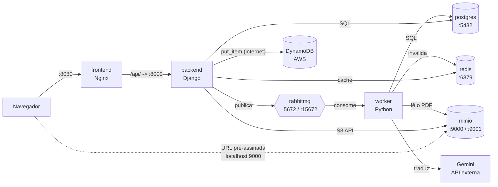

# Docker e Docker Compose (Trabalho 2)

Material de estudo para a arguição do trabalho 2: como a aplicação do trabalho 1 foi colocada em containers e o que substituiu cada serviço da AWS.

Tudo aqui foi escrito a partir do código do repositório (`docker-compose.yml`, os três `Dockerfile`, `frontend/nginx.conf`, `.github/workflows/deploy.yml`, `backend/` e `worker/`). Onde algo é uma limitação ou ainda não foi feito, está dito em [07-estudo-arguicao.md](07-estudo-arguicao.md).

## Arquivos

| Arquivo | Conteúdo |
|---|---|
| [01-compose.md](01-compose.md) | O `docker-compose.yml` inteiro: serviços, rede, volumes, `depends_on`, healthchecks, `.env` |
| [02-postgres-minio-redis.md](02-postgres-minio-redis.md) | Os três containers de dados: Postgres, MinIO e Redis |
| [rabbitmq.md](rabbitmq.md) | RabbitMQ: fila, ack, DLQ, produtor e consumidor (já existia) |
| [03-dockerfiles.md](03-dockerfiles.md) | Dockerfiles do backend, do worker e do frontend, linha a linha |
| [04-frontend-nginx.md](04-frontend-nginx.md) | Nginx servindo as telas e fazendo proxy de `/api` |
| [05-dynamodb-e-credenciais.md](05-dynamodb-e-credenciais.md) | O único serviço que continua na AWS e como o container chega até ele |
| [06-ci-deploy.md](06-ci-deploy.md) | Pipeline do GitHub Actions que faz o deploy com `docker compose` |
| [07-estudo-arguicao.md](07-estudo-arguicao.md) | Perguntas prováveis, respostas e limitações conhecidas |

## Da AWS para o Docker: o que mudou

| Trabalho 1 (AWS) | Trabalho 2 (Docker) | Imagem / origem | Exigência da spec |
|---|---|---|---|
| RDS PostgreSQL | Container `postgres` | `postgres:16` | 1b e 4 |
| S3 (PDFs) | Container `minio` | `cgr.dev/chainguard/minio:latest` | 1c e 5 |
| SNS + SQS | Container `rabbitmq` | `rabbitmq:3-management` | 1d e 6 |
| ElastiCache Redis | Container `redis` | `redis:7-alpine` | (não exigido; foi mantido) |
| DynamoDB | **Continua na AWS** | serviço gerenciado | 1a |
| EC2 da API | Container `backend` | Dockerfile próprio (`backend/`) | 2 |
| EC2 do worker | Container `worker` | Dockerfile próprio (`worker/`) | 2 (pontuação cita o worker) |
| Bucket S3 do site | Container `frontend` | Dockerfile próprio (`frontend/`), Nginx | 3 |
| ALB + Auto Scaling | Não há equivalente | (o Nginx do front faz o papel de ponto de entrada) | — |

O código quase não mudou: o MinIO fala o protocolo S3, então continua sendo o `boto3`, só com `endpoint_url`. O que mudou foi a configuração (variáveis do `.env`) e o `messaging.py`, que passou de SNS para `pika` (RabbitMQ).

## Arquitetura



Tudo dentro do retângulo acima, exceto DynamoDB e Gemini, está na rede `artigos-network` e se enxerga pelo nome do serviço (`postgres`, `minio`, `rabbitmq`, `redis`, `backend`).

## Como o fluxo funciona (em containers)

1. O navegador abre `http://localhost:8080` (container `frontend`, Nginx).
2. As telas chamam `/api/...` na mesma origem. O Nginx reescreve e encaminha para `http://backend:8000`.
3. Cadastro de artigo: o backend grava os metadados no `postgres`, envia o PDF ao `minio`, apaga o cache no `redis`, grava o log no DynamoDB e publica o evento no `rabbitmq`. Responde na hora com o artigo `PENDENTE`.
4. O `worker` recebe o evento, marca `PROCESSANDO`, lê o PDF do `minio`, traduz o resumo com o Gemini, grava no `postgres` e marca `PROCESSADO`. Só então dá `ack`.
5. Download: o backend gera uma URL pré-assinada do MinIO apontando para `localhost:9000`. O navegador baixa direto do MinIO, sem passar pela API.

## Comandos que você precisa saber explicar

```
cp .env.example .env            # preencher usuários, senhas, GEMINI_*, credenciais AWS
docker compose build            # gera as imagens backend, worker e frontend
docker compose up -d            # sobe os sete serviços
docker compose ps               # estado e health de cada um
docker compose logs -f worker   # logs de um serviço
docker compose exec backend python manage.py migrate   # cria as tabelas (ver limitações)
docker compose down             # para e remove containers e rede (os volumes ficam)
docker compose down -v          # também apaga os volumes: perde banco, PDFs e filas
```

Painéis para as evidências: MinIO `http://localhost:9001`, RabbitMQ `http://localhost:15672`, telas `http://localhost:8080`, API direta `http://localhost:8000`.
